<p align="center">
  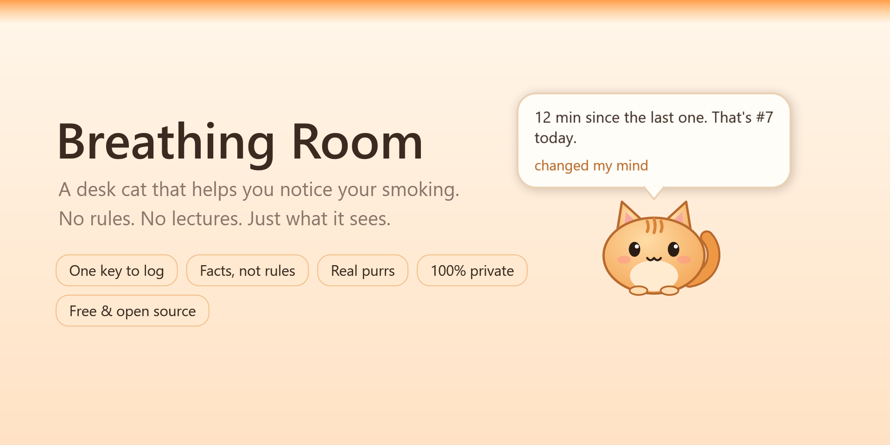
</p>

<p align="center">
  <a href="https://github.com/richard-nodev/breathing-room/releases/latest"></a>
  
  <a href="LICENSE"></a>
  
</p>

**Breathing Room puts a small cat named Mochi in the corner of your screen.** Press <kbd>Ctrl</kbd>+<kbd>Alt</kbd>+<kbd>S</kbd> when you light a cigarette, and Mochi tells you, plainly, how long it's been and how many that makes today.

That's it. No countdowns, no targets, no "too early", no lectures. Just the one moment of noticing that autopilot never gives you.

> Most extra cigarettes aren't decisions. You're deep in a game or waiting for something to load, and you light one five minutes after the last without even noticing. Breathing Room is built for exactly that moment.

---

## What it does

<table>
<tr>
<td width="50%">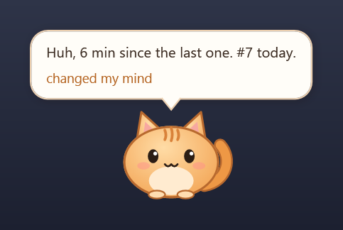</td>
<td>

### One key. Plain facts.
<kbd>Ctrl</kbd>+<kbd>Alt</kbd>+<kbd>S</kbd> works from inside a game, with no alt-tab. Mochi answers with what it sees: the time since your last one, today's count, your longest stretch. If it was quick: *"Huh, 6 min since the last one."*

Changed your mind? One click un-logs it.

</td>
</tr>
<tr>
<td width="50%">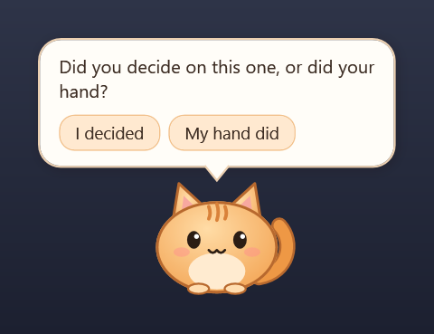</td>
<td>

### Curiosity, not willpower
Now and then Mochi asks something light: *did you decide on this one, or did your hand? How's it tasting?* Answer with one click or ignore it. Over a week, your own answers start telling you things.

</td>
</tr>
<tr>
<td width="50%">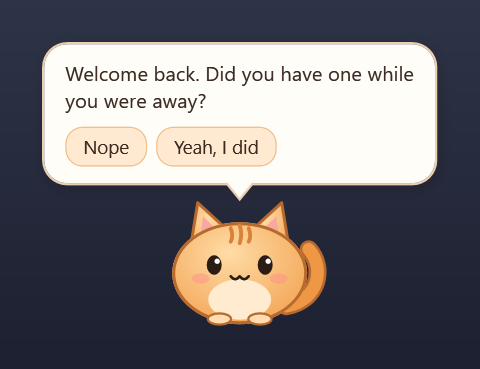</td>
<td>

### Honest, not perfect
Forgot to press the key? Mochi learns your usual gap and asks once if a gap runs unusually long, or when you come back from a break. You can add a forgotten one at any time.

</td>
</tr>
</table>

### How it's going, in plain sentences

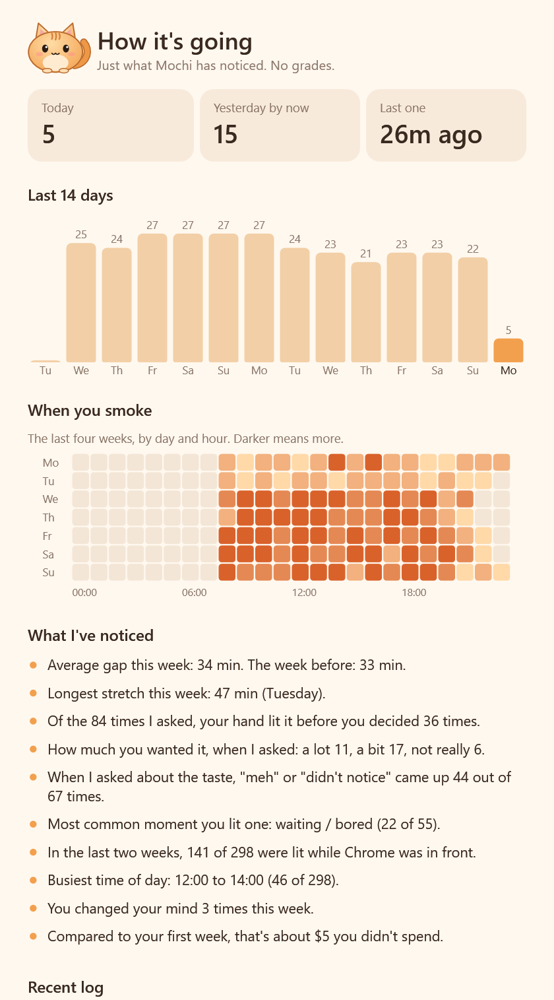

- Today vs. yesterday at the same time, and a 14-day chart
- **When you smoke:** a day-by-hour heatmap of the last four weeks
- Your average gap this week vs. last week, and your longest stretch
- *"Of the 84 times I asked, your hand lit it before you decided 36 times."*
- *"Most common moment you lit one: waiting / bored."*
- Which app was in front (optional), your busiest hours, urges that passed
- A short weekly recap from Mochi, plus your first-week vs. last-7-days numbers

No scores, no grades, no streaks to lose.

<br clear="right">

### The screen edge remembers

After each cigarette a warm **afterglow** fades along the top of your screen over about an hour. You'll catch it out of the corner of your eye in the middle of a match: *the edge is still warm, I just had one.* It has no number and no "allowed now" moment, so there's nothing to count down to.

There's also an optional tiny corner badge, `12m · #7 today`, if you like numbers.

### Something to do with your hands

Click Mochi and pick **Let's play**. There are nine games, and Mochi is in every one.

**Two bigger ones**, for when you want something that takes all of your attention for a while.

| | |
|---|---|
| 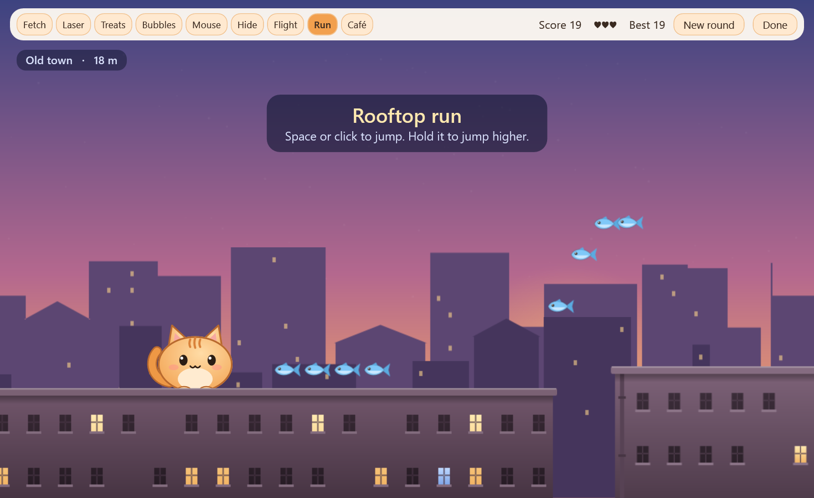 **Rooftop run**: one night across town, from sunset to sunrise. Tap to hop a chimney, hold to clear a wide alley. Every part of town brings something new: washing lines to run under, market awnings that bounce you up, a slow balloon ride, a night train, lantern lines to slide along, the harbor, and gardens at dawn. It's made to absorb, not to stress: the pace stays steady, a slip eases things off instead of piling on, and each new part of town brings a heart back. Collect a postcard from every one. | 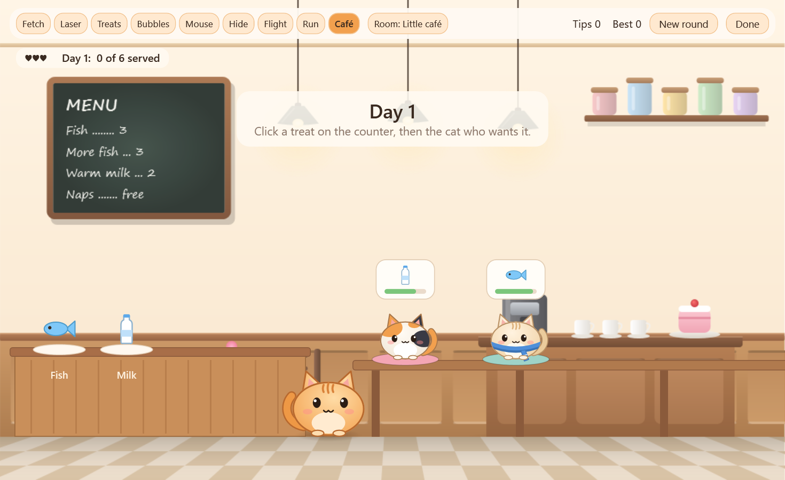 **Café rush**: cats drop in for fish, milk, cake and cookies. Click a treat, then the cat who wants it, and Mochi serves it. Mochi carries two at a time and your clicks queue up, so a good plan saves trips. Every day brings more guests with less patience. |

**Seven quick ones** for loading screens, builds and other empty minutes. Most play in four rooms that follow the real time of day: morning light, a sunset in the evening, lamps and fireflies at night.

| | |
|---|---|
| 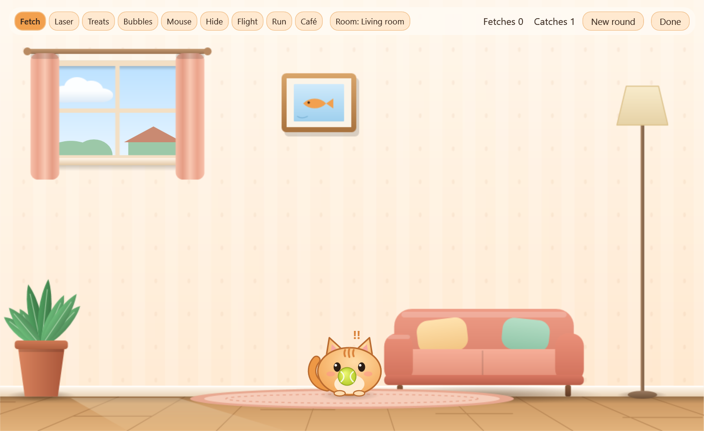 **Fetch**: throw the ball, Mochi brings it back to your cursor. | 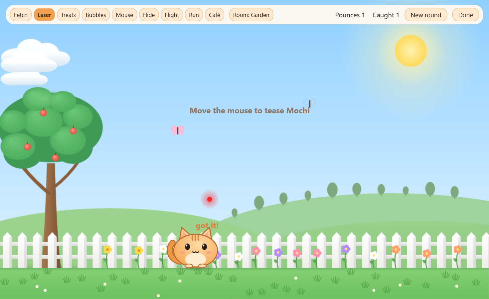 **Laser**: move the red dot and watch Mochi stalk, wiggle and pounce. |
| 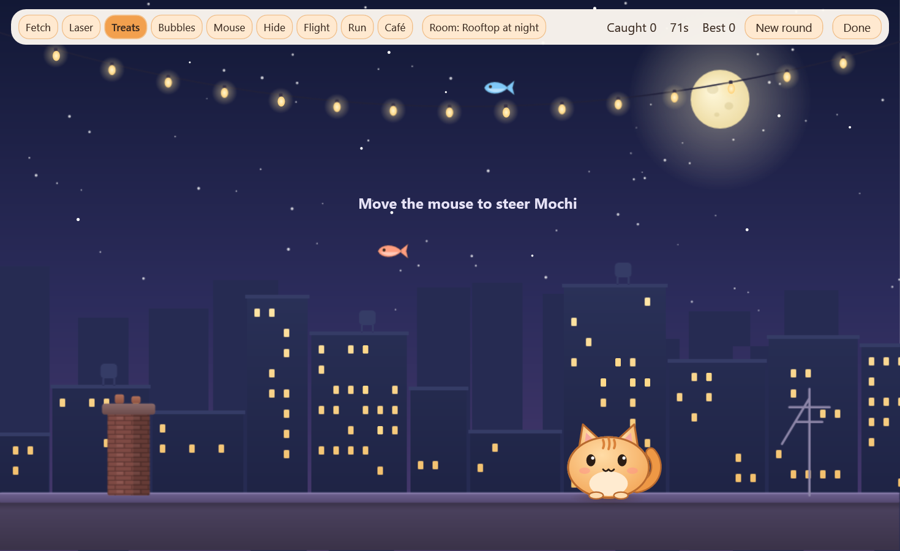 **Treats**: steer Mochi to catch falling fish. | 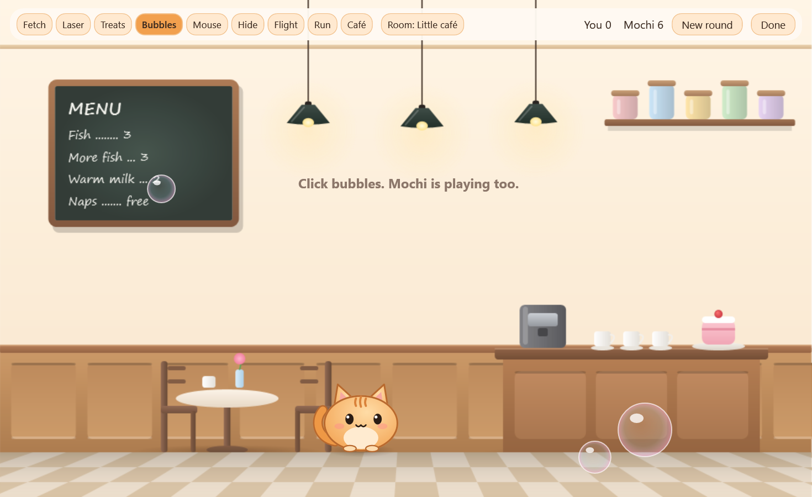 **Bubbles**: pop them before Mochi does. |

| | |
|---|---|
| 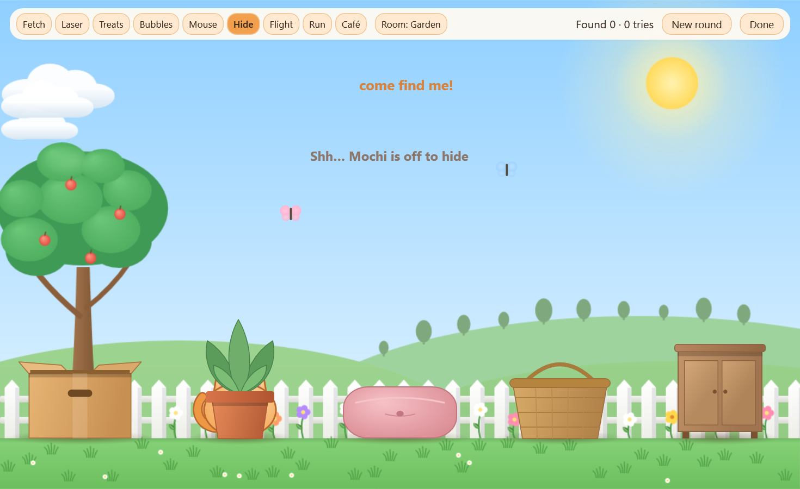 **Hide & seek**: find Mochi. Only the tip of its tail gives it away. | 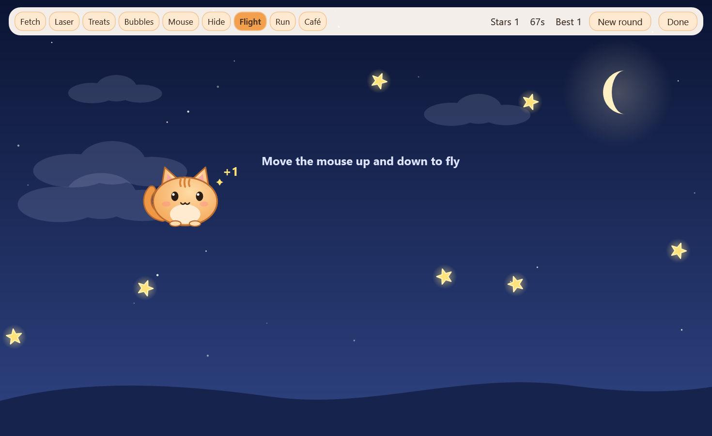 **Night flight**: a calm dream through the clouds, collecting stars. |

And **Toy mouse**: wind up a toy mouse, let it go, and watch Mochi hunt it.

### Ride it out

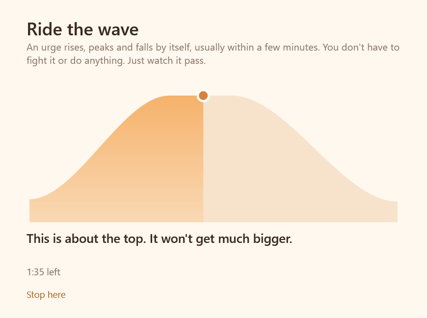

An urge rises, peaks and falls by itself, usually within a few minutes. **Ride the wave** is three calm minutes of watching that happen while Mochi purrs, an approach known as *urge surfing*. If you'd rather breathe, **Breathe with me** is a one-minute version: Mochi slowly puffs up and settles.

Afterwards Mochi asks *"Still want one, or did it pass?"*. Either answer is fine, and urges that pass show up in *How it's going*.

<br clear="right">

### Up for a stretch

After an hour at the PC, Mochi suggests standing up for a bit: a stretch, a glass of water, a few steps by the window. *Not now* is always fine, and it never interrupts a fullscreen game. Choose 45 minutes, an hour, 90 minutes or never in Settings.

### Make Mochi yours

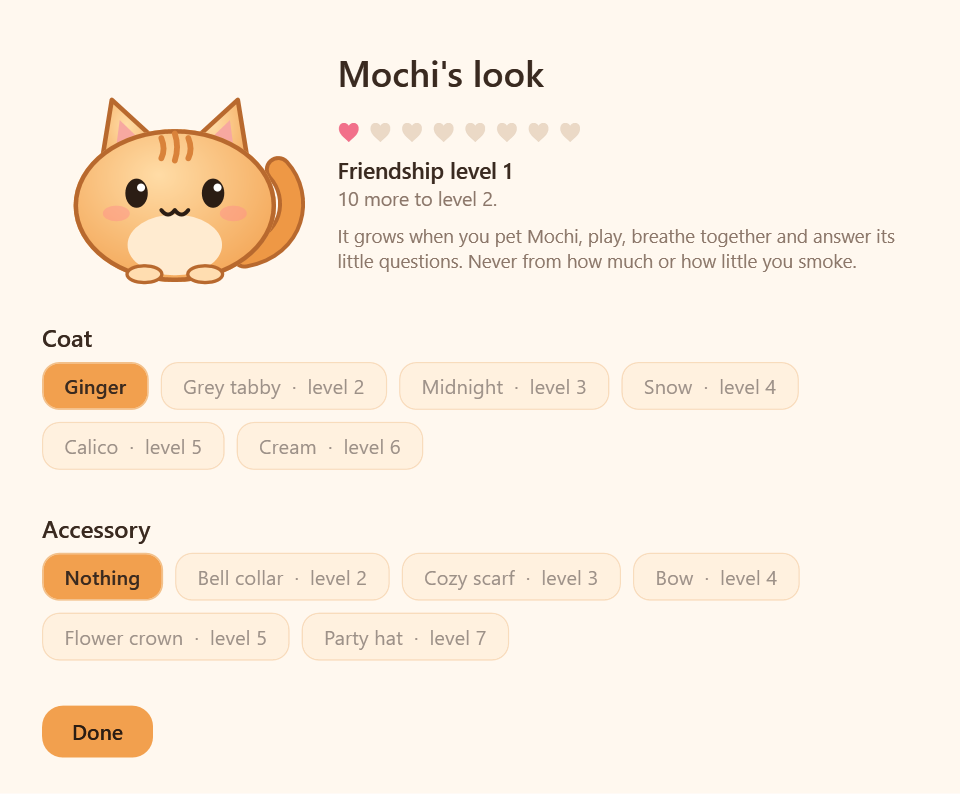

Six coats (ginger, grey tabby, midnight, snow, calico, cream) and accessories (a bell collar, a cozy scarf, a bow, a flower crown, a party hat). They unlock as your **friendship** grows. Friendship comes from time together: petting, playing, breathing, and answering Mochi's questions. **Never from how much or how little you smoke.**

### A real cat's voice

Pet Mochi by moving the mouse over it and it purrs. Every sound is a **real cat recording**, with nothing synthesized. Some meows sound like ducklings to some ears, so in **Mochi's voice** you listen to each clip and tick when Mochi may use it.

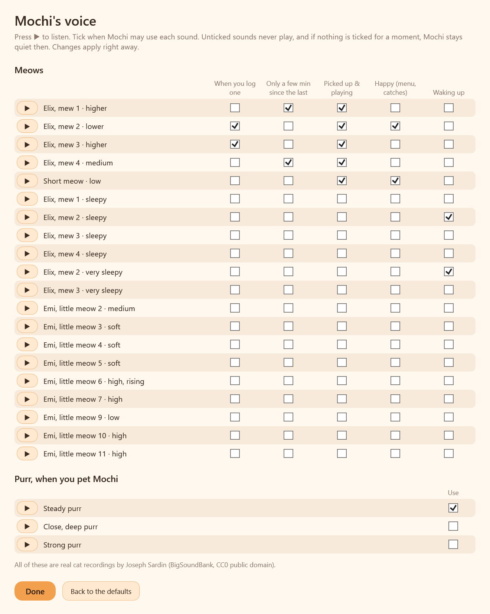

---

## Get it

1. Download `BreathingRoom-…-windows.zip` from the [latest release](https://github.com/richard-nodev/breathing-room/releases/latest) and unzip it anywhere.
2. Double-click **BreathingRoom.exe**. There's nothing to install, and it runs on Windows 10 and 11.
3. Windows may say it *protected your PC*, because the app isn't code-signed. Click **More info → Run anyway**. Or [build it yourself](#build-it-yourself) in one command.

A one-screen welcome appears the first time. After that, Mochi lives in the bottom-right corner, and the tray icon by the clock has everything else.

## Using it

| | |
|---|---|
| <kbd>Ctrl</kbd>+<kbd>Alt</kbd>+<kbd>S</kbd> | Log a cigarette. Press it right when you light one. Tip: put a small sticker on your lighter. |
| **Click Mochi** | See the time since your last one, and the menu: log, play, breathe, a forgotten one, *How it's going*, nap for an hour, settings. |
| **Pet Mochi** | Move the mouse back and forth over the cat. It leans into your hand, and the purr grows the longer you pet. |
| **Drag Mochi** | Move it anywhere. |
| **Tray icon** | Log one, add a forgotten one, *How it's going*, play, the on-screen switches, Mochi's voice, Settings, About and Quit. Double-click it for *How it's going*. |

**Settings** lets you rename the cat, change the log key, choose how often Mochi asks questions and suggests a stretch, and switch each on-screen element on or off. It also has sound, startup with Windows, update checks, an optional pack price (for one money line), and your data.

## Updates

When a new version is out, Mochi mentions it once, and **Update now** appears in the tray menu and in *About*. One click downloads the new version from this project's GitHub releases, checks it against its published SHA-256 checksum, puts it in place and restarts. Your data and settings stay as they are. If anything goes wrong, the old version keeps running.

## Private by design

- **Everything stays on your PC**, in `%APPDATA%\BreathingRoom\data.json`.
- **No account, no telemetry.** The only thing the app ever asks the internet is whether a new version is out: about once a day it reads this project's public release page on GitHub. Nothing about you is sent, and you can switch it off in Settings.
- **Your data is yours:** export to CSV, open the folder, or delete your history from Settings.
- **App names are optional:** if you'd rather the app didn't remember which program was in front when you logged, switch that off.

## Why it works this way

Breathing Room is built on a few well-studied ideas:

- **Self-monitoring:** just noticing and logging tends to reduce smoking on its own.
- **Curiosity-based attention:** paying attention to what a cigarette is actually like, rather than fighting it.
- **Autonomy:** information and choices instead of instructions, because rules make many people do the opposite. A countdown also turns the next cigarette into an appointment.

The full reasoning is in [docs/DESIGN.md](docs/DESIGN.md).

## FAQ

<details>
<summary><b>Will it tell me to quit?</b></summary>

No. It never tells you what to do. It shows you what it notices, and you decide what to do with it.
</details>

<details>
<summary><b>I play games in fullscreen. Will I see Mochi?</b></summary>

Over borderless and windowed games, yes. *Exclusive* fullscreen hides every other window. For that case you can switch on **Spoken facts** in Settings, and the Windows voice will say the fact out loud. The log key works either way.
</details>

<details>
<summary><b>Does it slow my games down?</b></summary>

No. Like a real cat, Mochi mostly sits still: a blink, a tail flick now and then. It keeps completely still while a fullscreen game or video is in front, and stops animating while it's hidden. Idle, the whole app uses about 2% of one CPU core. Overlays never take focus, and clicks pass through everything except the cat and its bubble.

The play window pauses whenever it isn't in front and caps itself at about 60 frames a second. In the first game after the app starts, it checks whether this PC draws it faster on the graphics card or in software, and sticks with the faster way. Some virtual machines and remote desktops are several times smoother in software.
</details>

<details>
<summary><b>I pressed the key by mistake.</b></summary>

Click *changed my mind* in Mochi's bubble, or remove the entry in *How it's going*.
</details>

<details>
<summary><b>Can I use my own sounds?</b></summary>

Yes. Put `.wav` files named `purr`, `mew`, `trill`, `question`, `happy` or `yawn` (e.g. `mew1.wav`) in the sounds folder. Settings → *Open the sounds folder*.
</details>

<details>
<summary><b>How do I uninstall it?</b></summary>

Untick *Start with Windows* in Settings, quit from the tray icon, and delete `BreathingRoom.exe`. To remove your data too, delete `%APPDATA%\BreathingRoom`.
</details>

## Build it yourself

You need Windows 10 or 11, and nothing else. The C# compiler that ships with Windows does the work.

```bat
git clone https://github.com/richard-nodev/breathing-room.git
cd breathing-room
build.cmd
```

This runs the tests and puts the app in `bin\BreathingRoom.exe`. `build.cmd package` also makes the release zip. See [CONTRIBUTING.md](CONTRIBUTING.md) for the project layout, test mode and the UI smoke test.

## Contributing

Ideas, bug reports and pull requests are welcome. There's one rule: **the app notices; it never tells people what to do.** Read [CONTRIBUTING.md](CONTRIBUTING.md) and the [Code of Conduct](CODE_OF_CONDUCT.md).

Help especially wanted with:

- **Translations**, so Mochi can talk to people in their own language.
- **Multiple monitors:** today Mochi lives on the main screen.
- **More rooms and games** for the play window.
- **Real recordings** (CC0) for more game sounds: birds in the garden, a passing train, gulls at the harbor.

## Not medical advice

Breathing Room is a noticing tool, not a treatment. If you ever want help to cut down or quit, free and friendly support exists. [Smokefree.gov](https://smokefree.gov/) (US), [NHS Quit Smoking](https://www.nhs.uk/better-health/quit-smoking/) (UK), or your local quitline and doctor are good places to start.

## Credits

- **Cat recordings:** Joseph Sardin, [BigSoundBank](https://bigsoundbank.com/), CC0 public domain. Details in [assets/sounds/CREDITS.txt](assets/sounds/CREDITS.txt).
- **Mochi:** drawn in code, with plain shapes and a lot of care.

## License

[MIT](LICENSE). Free to use, change and share.
